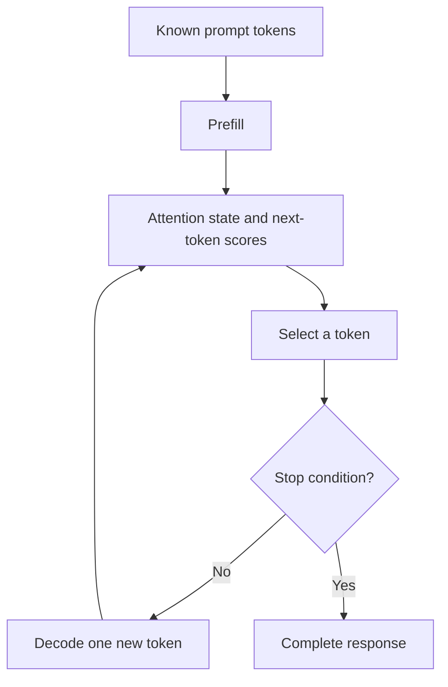

A text-generation API hides a useful distinction. Before producing the first output token, a transformer must process the supplied context. After that, it repeatedly extends the sequence. Both phases use the model, but they arrange its work differently.

## From text to a prediction

A tokenizer maps text into token identifiers. The model turns those identifiers into vectors, updates them through its layers, and produces scores for the next token. A decoding rule selects a token from those scores. That selection is appended to the context for the next step.

The model does not select an entire paragraph in one operation. In ordinary autoregressive decoding, later tokens depend on earlier selections. This creates a sequential dependency even when the operations within a step are highly parallel.

## Prefill processes the supplied sequence

During prefill, the input tokens are already known. Their representations can be computed together under a causal mask, which prevents a position from using future tokens. This does not make their semantic dependencies disappear; it lets the matrix operations express those dependencies across a batch of known positions.

The result includes the information needed to predict a continuation and attention state that can be reused in later steps. A longer prompt generally creates more input work and more state. The exact scaling depends on attention structure and implementation.

## Decode extends the state

At each ordinary decode step, there is one new token per active sequence to process. Keys and values for preceding positions can be retained rather than recomputed. The model still needs to combine the new query with relevant preceding state.

A useful simplified loop looks like this:

```python
# Educational pseudocode; not a framework API.
state, logits = prefill(prompt_tokens)
for _ in range(output_budget):
    token = choose_next_token(logits)
    if token == end_of_sequence:
        break
    emit(token)
    state, logits = decode_one(token, state)
```

The loop makes a dependency visible: choosing the next token requires the preceding result. Speculative methods can change the execution strategy, but this is a useful reference model before considering them.[^scope]

## A diagram of the dependency

The following Mermaid source is editable and copyable. Use **Render diagram** to view it; rendering code loads only on demand.



## What the distinction buys

A single throughput figure can mix different execution shapes. A service processing long prompts and short outputs may spend its time differently from one processing short prompts and long outputs. The same model and hardware can produce different measurements under those workloads.

For a first experiment, keep prompt length and output length separate. Measure time to first token and time for the complete output. Record concurrency and batching as well. Otherwise, an improvement in one phase can be hidden by a change in the other.

### Further reading

[Hugging Face's explanation of inference caches](https://huggingface.co/docs/transformers/main/en/cache_explanation) describes how attention state is retained during generation. The [next chapter](/books/llm-inference/memory-and-batching/) develops the memory budget implied by that state.

[^scope]: This is a reference description of autoregressive transformer generation, not a claim that every language-model architecture or decoding method follows this exact loop.
